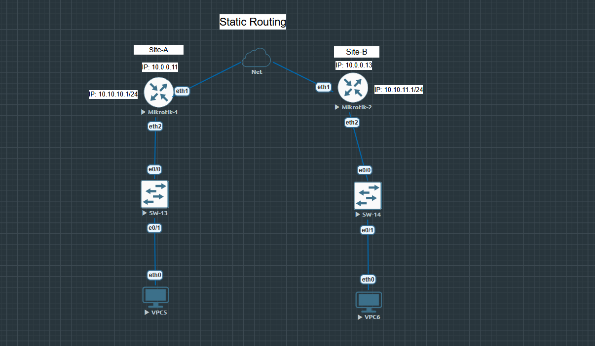
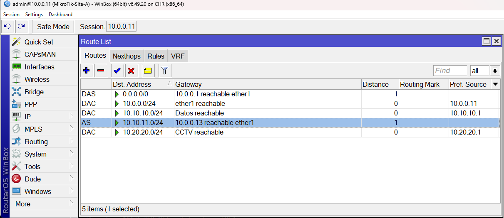
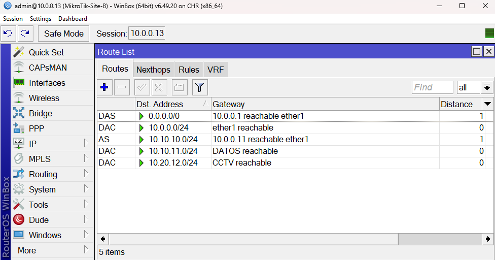

# Mikrotik-Statics-Routes
Laboratorios Mikoritk Practicando enrutamiento estatico entre dos redes conectadas entre si

2. Descripción de la topología

La infraestructura está compuesta por dos segmentos de red. Cada uno tiene un router MikroTik que funciona como gateway de su LAN y un switch Cisco 2960 para conectar los dispositivos finales.
- Sitio A: MikroTik A, dirección 10.0.0.11, conectado a un Cisco Catalyst 2960. La VLAN 10 utiliza la red 10.10.10.0/24.
- Sitio B: MikroTik B, dirección 10.0.0.13, conectado a otro Cisco Catalyst 2960. La VLAN 10 utiliza la red 10.10.11.0/24.
- Enrutamiento: rutas estáticas para alcanzar la red LAN remota a través del otro MikroTik.
Las dos redes utilizan el mismo identificador de VLAN, pero pertenecen a subredes IP diferentes. Esto es válido porque la VLAN 10 del sitio A y la VLAN 10 del sitio B están en dominios de capa 2 separados, suponiendo que no existe un enlace de capa 2 que las una directamente.

3. Diagrama de red

Este es el esquema lógico:

4. Tabla de direccionamiento IP
   
Incluye una tabla como esta en el README de GitHub.

Dispositivo	Interfaz o segmento	Dirección IP	Función

MikroTik A	Tránsito	10.0.0.11/24	Comunicación entre routers

MikroTik A	Gateway VLAN 10	10.10.10.1/24	Gateway de la LAN A

Cisco 2960 A	VLAN 10	Capa 2	Conmutación LAN A

PC-A	VLAN 10	10.10.10.250/24	Equipo de prueba

MikroTik B	Tránsito	10.0.0.13/24	Comunicación entre routers

MikroTik B	Gateway VLAN 10	10.10.11.1/24	Gateway de la LAN B

Cisco 2960 B	VLAN 10	Capa 2	Conmutación LAN B

PC-B	VLAN 10	10.10.11.254/24	Equipo de prueba

5. Lógica del enrutamiento estático

Cada MikroTik conoce su propia red directamente conectada, pero necesita una ruta adicional para llegar a la LAN remota.

